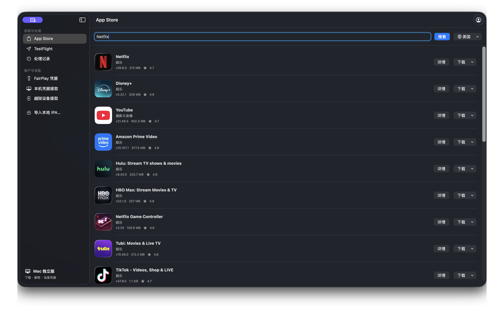
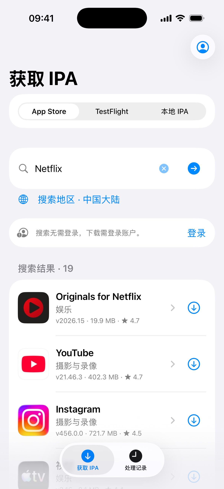

# IPA 解密

面向 iOS 和 macOS 的 IPA 下载、解密与凭据管理工具，支持 App Store、TestFlight 及本地 IPA，提供历史版本选择、FairPlay 凭据管理与局域网文件分享。

[下载安装](https://github.com/Re13orn/IPA-Decrypt/releases/latest) · [所有版本](https://github.com/Re13orn/IPA-Decrypt/releases) · [安装指南](docs/INSTALLATION.md) · [构建文档](docs/BUILDING.md)

| 平台 | 版本 | 系统要求 |
| --- | --- | --- |
| iOS | [1.0.0](https://github.com/Re13orn/IPA-Decrypt/releases/tag/v1.0.0) | iOS 16 及以上 |
| macOS | 1.0.3 | Apple Silicon · macOS 15 及以上 |

当前发布系列为 `1.0`；macOS 为 `1.0.3`，iOS 保持 `1.0.0`，详见 [版本策略](docs/VERSIONING.md)。

## 界面预览

### macOS

应用搜索、地区切换与下载操作。



### iOS

<table>
  <tr>
    <th align="center">应用搜索</th>
    <th align="center">应用详情</th>
  </tr>
  <tr>
    <td align="center"></td>
    <td align="center"></td>
  </tr>
</table>

截图中的应用信息随商店地区与版本更新变化。

## 核心功能

| 功能 | 说明 |
| --- | --- |
| 应用检索 | 按名称、App ID、Bundle ID 或商店链接搜索，查看评分、大小、兼容性、截图与版本说明 |
| IPA 下载 | 管理 App Store 与 TestFlight 账户，查看下载进度、任务状态并选择历史版本 |
| 解密与导出 | 校验许可证与凭据匹配，处理本地或已下载 IPA，导出原始包和解密包 |
| 凭据管理 | 导入 `credential.bin`、十六进制数据或 Mac 本机模型，按内容去重，管理账户标签及记录 |
| 文件分享 | 通过系统共享或局域网页面下载导出文件 |
| 本机提取 | Mac 从本机注册状态恢复并验证 FairPlay 模型，无需越狱设备 |
| 设备提取 | Mac 通过 USB / SSH 从越狱设备批量提取 16 字节凭据，支持连接测试与重复结果合并 |
| 会话恢复 | 使用已保存密码恢复过期 App Store 会话，并支持交互式验证码验证 |

历史版本与下载权限以服务器返回结果及账户授权为准。

## 安装与使用

从 [Releases](https://github.com/Re13orn/IPA-Decrypt/releases) 下载对应平台附件：

- **macOS**：可从本机商店注册状态恢复 FairPlay 模型，无需越狱设备；已有越狱设备提取流程继续可用。打开 ARM64 DMG，将「IPA 解密.app」拖入「应用程序」。安装包内置 Python 与 USB 运行依赖。
- **iOS**：下载未签名 IPA，使用适用于目标设备的有效签名后安装。

Mac 当前采用 ad-hoc 签名，未公证。文件校验、系统安装提示及首次使用步骤见 [安装指南](docs/INSTALLATION.md)。

## 源码构建

开发环境采用 Apple Silicon Mac 与 Xcode。原生依赖和运行资源准备完成后，可使用统一入口构建：

```sh
python3 scripts/verify-dependencies.py
bash scripts/test.sh
bash scripts/build.sh macos
bash scripts/build.sh ios
```

原生库重建、运行资源配置、Python 引导与打包流程见 [构建文档](docs/BUILDING.md)。源码与发行包的依赖范围见 [依赖清单](docs/DEPENDENCIES.md)。

## 文档

| 文档 | 内容 |
| --- | --- |
| [安装指南](docs/INSTALLATION.md) | 平台安装、签名、凭据导入与常见问题 |
| [发布说明](docs/RELEASE_NOTES.md) | 当前版本、下载附件与验证范围 |
| [兼容性记录](docs/PORTABILITY.md) | 安装包检查与平台测试结果 |
| [已知问题](docs/KNOWN_ISSUES.md) | 服务依赖、系统兼容与功能限制 |
| [数据与隐私](docs/PRIVACY.md) | 账户、密码、凭据及分享数据的存储与使用 |
| [贡献指南](CONTRIBUTING.md) | 开发约定、验证要求与问题反馈 |

## 许可证与致谢

项目采用 [GPL-3.0](LICENSE)，第三方组件保留各自版权与许可，详见 [依赖清单](docs/DEPENDENCIES.md)。应用信息组织参考 [ipadn](https://github.com/mengangs/ipadn)，实现说明见 [界面设计参考](docs/UI_REFERENCE.md)。
