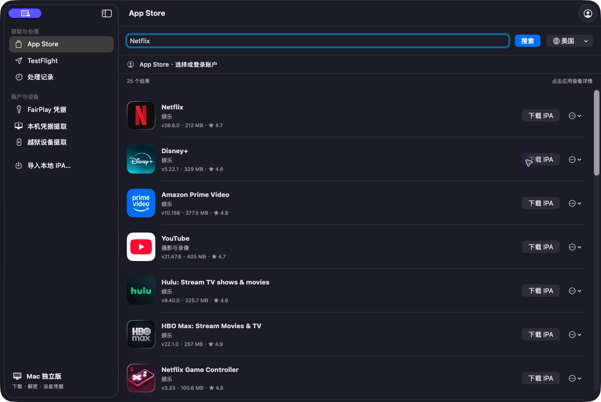
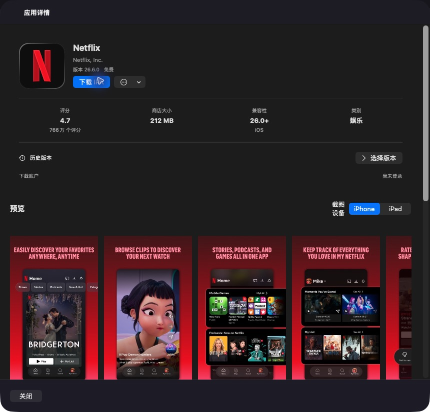
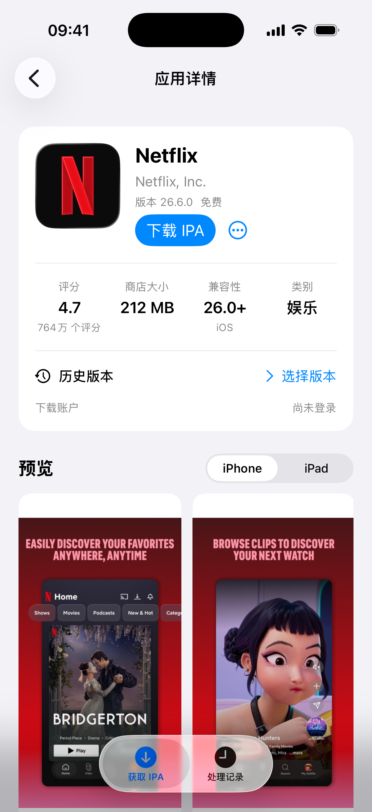

# IPA Decrypt

[English](README.md) · [简体中文](README.zh-CN.md)

[](https://github.com/Re13orn/IPA-Decrypt/releases/latest)
[](#download)
[](LICENSE)
[](https://github.com/Re13orn/IPA-Decrypt/actions/workflows/macos-compatibility.yml)

A graphical IPA downloader, FairPlay decryption tool, and credential manager for macOS and iOS. Work with App Store, TestFlight, and local IPA files in one interface.

**Recover and validate a local FairPlay model on a supported Apple Silicon Mac, without a jailbroken iPhone.** The Mac must have a compatible iPhone or iPad app installed from the Mac App Store. Model compatibility depends on Store registration state and the IPA's license.

## Download

| Platform | App version | Download | Requirements |
| --- | --- | --- | --- |
| macOS | **1.0.9** | [Apple Silicon DMG](https://github.com/Re13orn/IPA-Decrypt/releases/download/v1.0.9/IPA-Decrypt-macOS-1.0.9-arm64.dmg) | Apple Silicon · macOS 15+ |
| iOS | **1.0.3** | [Unsigned IPA](https://github.com/Re13orn/IPA-Decrypt/releases/download/v1.0.7/IPA-Decrypt-iOS-1.0.3-unsigned.ipa) | iOS 16+ · valid signing required |

[All releases and checksums](https://github.com/Re13orn/IPA-Decrypt/releases) · [Installation guide](docs/en/INSTALLATION.md)

Mac releases are ad-hoc signed and **not notarized**. See the installation guide for checksum verification and Apple's instructions for opening downloaded apps. iOS and Mac versions advance independently; the iOS 1.0.3 asset is hosted under release tag `v1.0.7`.

## Screenshots

### macOS

Mac 1.0.9, captured without a signed-in account.
App search, region selection, download actions, and access to credential tools.



<details>
<summary>App details</summary>



</details>

### iOS

<table>
  <tr><th>App search</th><th>App details</th></tr>
  <tr>
    <td></td>
    <td></td>
  </tr>
</table>

The iOS images illustrate the interface. Store content and layout can vary by region and app version.

## What you can do

| Workflow | macOS | iOS |
| --- | --- | --- |
| Search App Store by name, App ID, Bundle ID, or link | ✓ | ✓ |
| Download App Store and TestFlight IPAs | ✓ | ✓ |
| Choose available historical App Store versions | ✓ | ✓ |
| Import, decrypt, and export local IPA files | ✓ | ✓ |
| Import 16-byte `credential.bin` or 32-character hex | ✓ | ✓ |
| Recover a local Mac FairPlay model | ✓ | — |
| Extract and deduplicate credentials over USB / SSH from a jailbroken device | ✓ | — |
| Export files and share them over the local network | ✓ | ✓ |

Downloads and version availability depend on the service response and account authorization. App Store and TestFlight have independent account selections. Each credential is matched against the actual license; an account label does not establish compatibility.

## Getting started

1. Install the app for your platform. On iOS, sign the IPA before installation.
2. Select an App Store or TestFlight account, or import an existing IPA. App Store search does not require login.
3. Prepare matching credentials using one of the methods below.
4. Download or import an IPA. Open its processing record to inspect the result and export the original or decrypted file.

### Choose a credential source

| What you have | Method | Where the result works |
| --- | --- | --- |
| A supported Mac with a compatible App Store iPhone / iPad app installed | Recover and validate a local FairPlay model | Mac app |
| A jailbroken iPhone / iPad with SSH | Extract all supported sources, then deduplicate by credential bytes | Mac and iOS apps, using 16-byte credentials |
| An existing `credential.bin` or hex value | Import the file or paste its 32-character hexadecimal representation | Mac and iOS apps |

Mac models and 16-byte credentials are different formats. Models cannot be converted to `credential.bin` or pasted into the iOS hex importer. See the [credential guide](docs/en/CREDENTIALS.md) and [FAQ](docs/en/FAQ.md).

## Compatibility and validation

The Mac 1.0.9 package passed macOS 15 / arm64 startup, bundled helper checks, and actual ARM64 proof-engine execution with an empty cache and networking denied. The signature is checked again after execution. Apple authentication and downloads still require network access.

iOS releases are unsigned device builds. A complete first-install workflow on a new physical device remains to be accepted. TestFlight uses a non-public client protocol and may be affected by Apple service changes.

[Validation records](docs/PORTABILITY.md) · [Known issues](docs/en/KNOWN_ISSUES.md) · [Privacy and local storage](docs/en/PRIVACY.md)

## Build and contribute

Builds use Apple Silicon and an Xcode toolchain. Native libraries and external runtime inputs must be prepared before building; the source archive alone is not a complete login runtime.

```sh
python3 scripts/verify-dependencies.py
bash scripts/test.sh
bash scripts/build.sh macos
bash scripts/build.sh ios
```

[Build guide](docs/en/BUILDING.md) · [Dependency inventory](docs/DEPENDENCIES.md) · [Contributing](CONTRIBUTING.md)

For usage questions and ideas, use [Discussions](https://github.com/Re13orn/IPA-Decrypt/discussions). For reproducible defects, [file an issue](https://github.com/Re13orn/IPA-Decrypt/issues/new/choose) with the platform, app version, diagnostic code, and steps. Keep passwords, verification codes, session files, and real credentials out of reports.

## License and credits

[GPL-3.0](LICENSE). Third-party components retain their own licenses and notices; see the [dependency inventory](docs/DEPENDENCIES.md). App information layout was informed by [ipadn](https://github.com/mengangs/ipadn); see the [UI reference notes](docs/UI_REFERENCE.md).

If the project is useful to you, a star helps others discover it.
